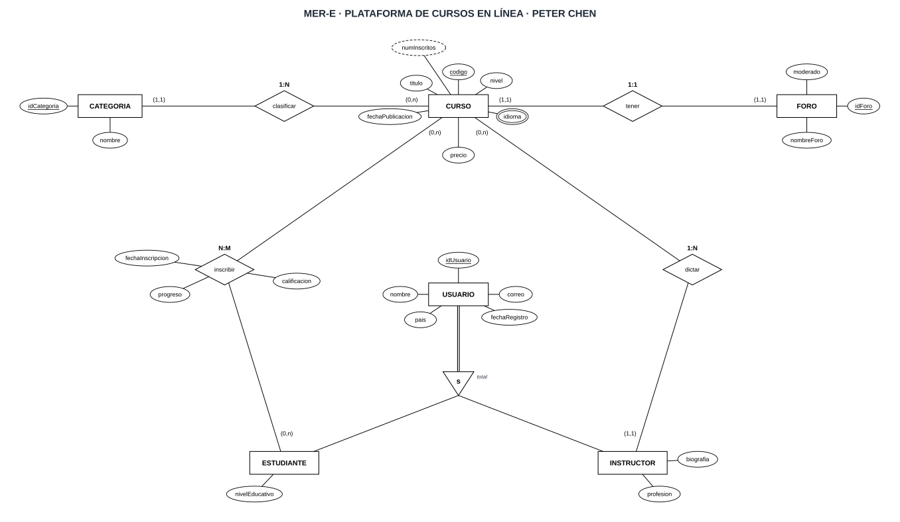
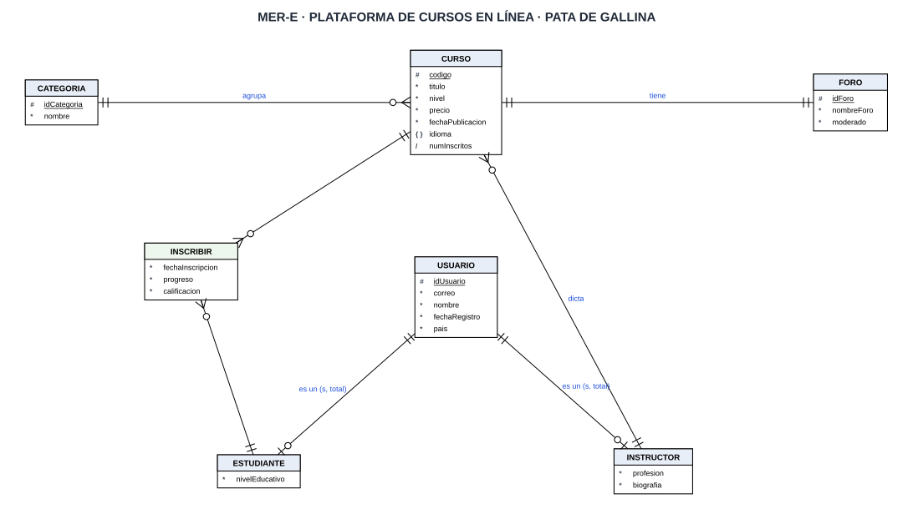
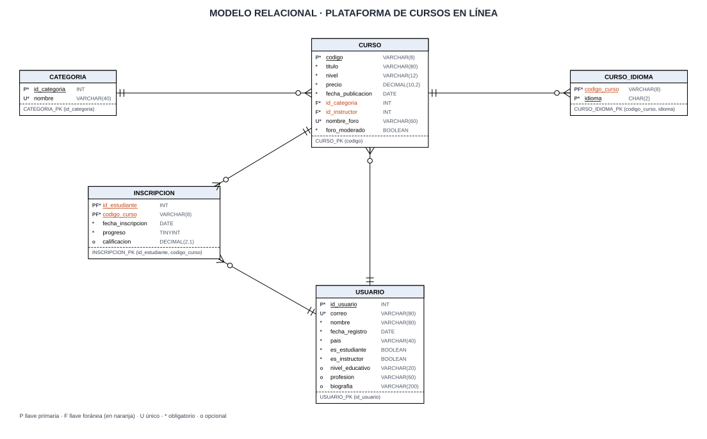

# Plataforma de cursos en línea

[← Volver al portafolio](../../README.md)

**Enunciado:** [CursosEnLinea.txt](CursosEnLinea.txt) · [CursosEnLinea.pdf](CursosEnLinea.pdf)

| Entregable | Archivos |
|---|---|
| MER · Peter Chen | [PDF](MER-Chen.pdf) · [drawio](MER-Chen.drawio) |
| MER · pata de gallina | [PDF](MER-PataDeGallina.pdf) · [drawio](MER-PataDeGallina.drawio) |
| MER-E · Peter Chen | [PDF](MERE-Chen.pdf) · [drawio](MERE-Chen.drawio) |
| MER-E · pata de gallina | [PDF](MERE-PataDeGallina.pdf) · [drawio](MERE-PataDeGallina.drawio) |
| Reducción a tablas | [Reduccion.md](Reduccion.md) |
| Modelo relacional | [PDF](Relacional.pdf) · [drawio](Relacional.drawio) |
| Normalización (0FN → 4FN) | [PDF](../../Normalizacion/CursosEnLinea.pdf) · [4FN](../../Normalizacion/README.md#cursosenlinea) |
| SQL (MySQL 8) | [Scripts 00–08](../../SQL/CursosEnLinea/) · [Consultas con resultado](../../SQL/CursosEnLinea/consultas.md) · [Álgebra relacional](../../SQL/CursosEnLinea/algebra.md) |

## MER-E · Peter Chen

## MER-E · pata de gallina

## Modelo relacional

